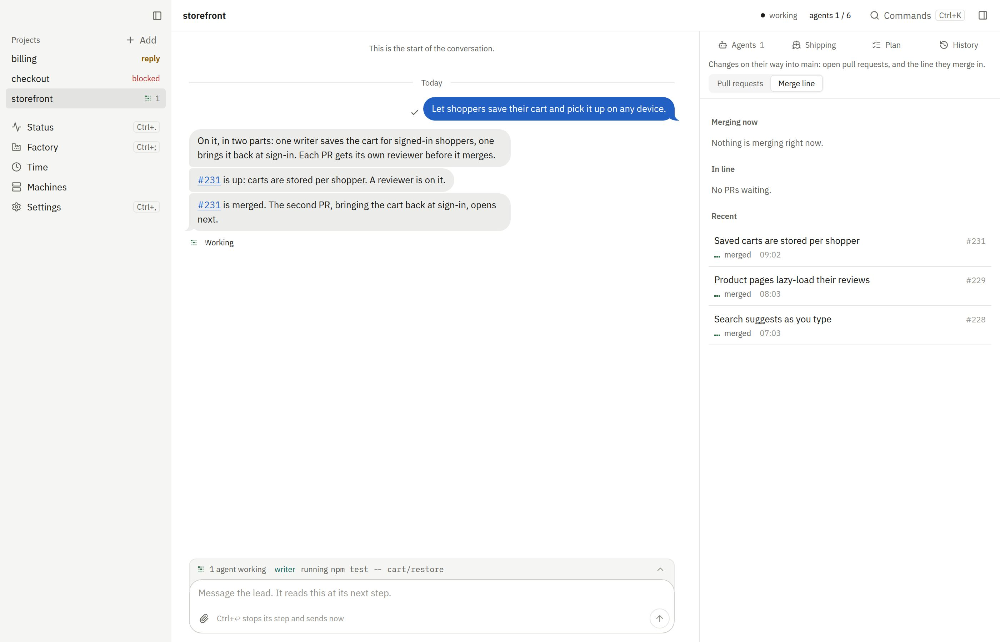

# fleetd

<!-- The showcase's poster; the recording itself plays on https://fleetd.sh (site/README.md). -->
[](https://fleetd.sh)

fleetd runs Claude Code on your machines: you type what you want, and it plans the work, runs the agents, opens pull
requests it has checked, and asks you only about real decisions.

```sh
curl -fsSL https://fleetd.sh | sh
```

**You need:** macOS or Linux x64, `git`, and the `claude` CLI where agents run. Claude runs on the hub's API key, your
subscription or each machine's login; GitHub through the hub's own GitHub App, or `gh`. `fleetd init` walks you
through them, the same steps as the app's first run. About a minute later the hub runs on this machine, the app is
paired, and you send the lead your first message.

Docs: [fleetd.sh/docs](https://fleetd.sh/docs)<br>
Contributing: [docs/CONTRIBUTING.md](docs/CONTRIBUTING.md)<br>
License: MIT
