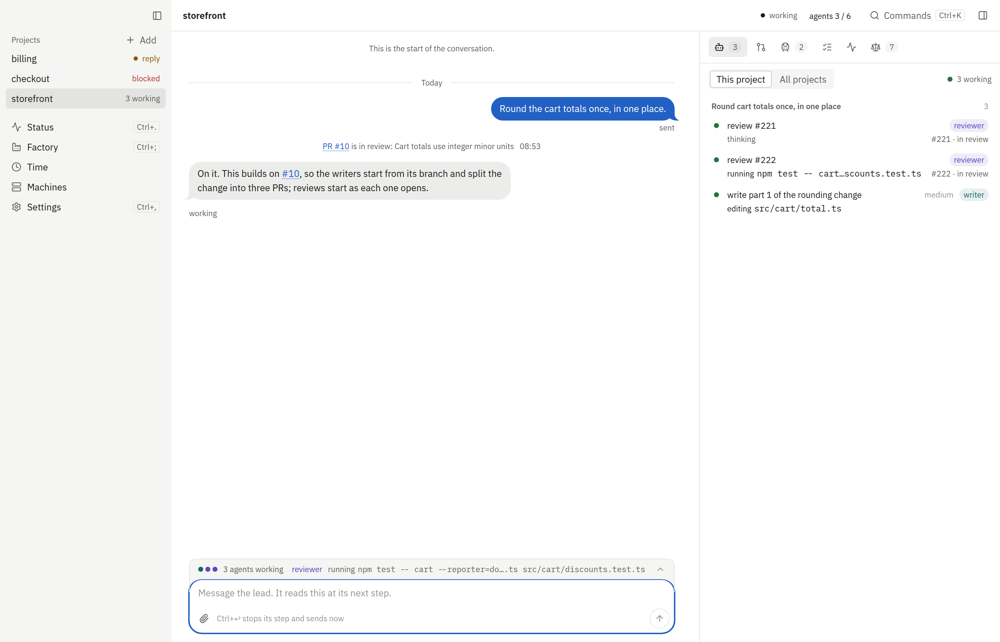

# fleetd

<!-- Clip slot: replace this screenshot with a 10–20 s clip of the app once it exists. -->


fleetd runs Claude Code on your machines: you type what you want, and it plans the work, runs the agents, opens pull
requests it has checked, and asks you only about real decisions.

```sh
curl -fsSL https://fleetd.sh | sh
```

**You need:** macOS or Linux x64, the `claude` CLI logged in (fleetd uses your own claude setup, including any proxy
in `~/.claude/settings.json`), `git`, and `gh` for pull requests. About a minute later the hub runs on this machine,
the app is paired, and you send the lead your first message.

Docs: [fleetd.sh/docs](https://fleetd.sh/docs)<br>
Contributing: [docs/CONTRIBUTING.md](docs/CONTRIBUTING.md)<br>
License: MIT
